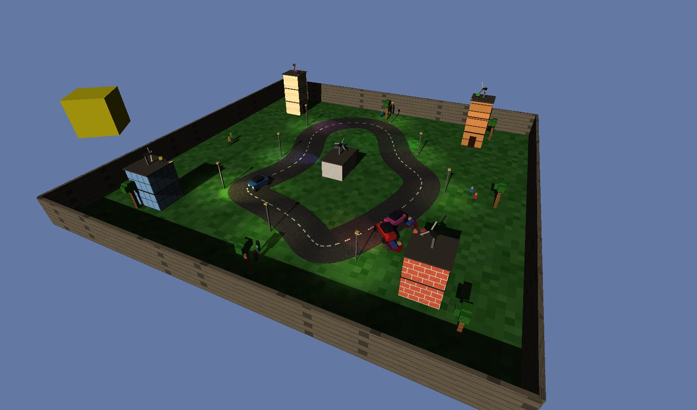
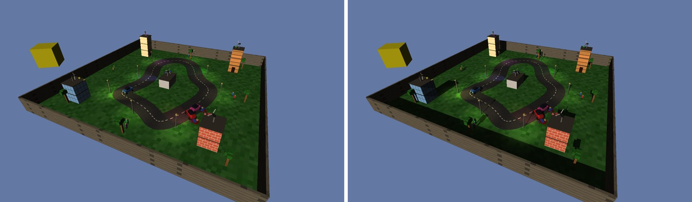
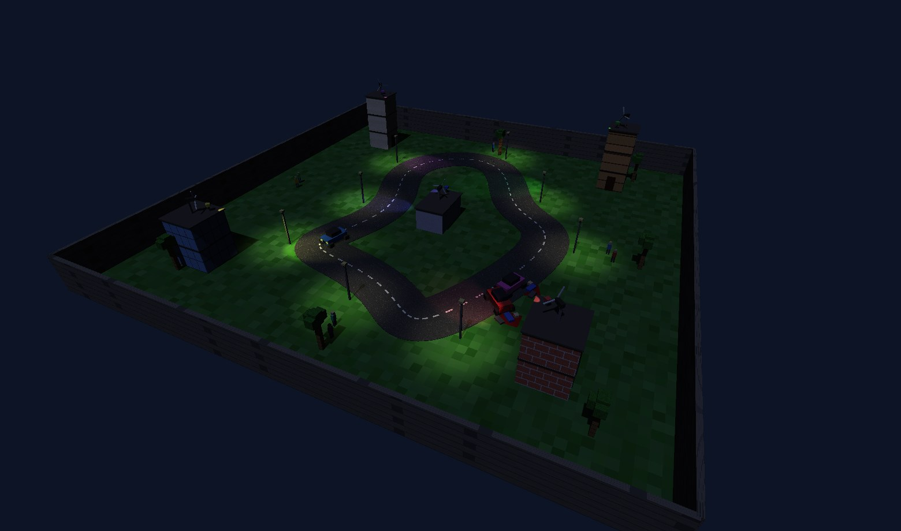

# opengl-car-world

A small 3D town in C++ and OpenGL 4.1, with no engine: a drivable car on a winding track, two AI cars, five textured buildings with windmills and swinging spotlights, street lamps, trees, people, and a sun and moon that cross the sky. It has sun and moon shadows, ten cameras and a headless mode that renders frames to PNG. It builds on macOS and Linux, and CI renders a frame with software OpenGL.



It started as assignment 3 of Computer Graphics (CSE7.302, IIIT Hyderabad, spring 2026): hierarchical scene modelling, lighting and texture mapping. After the course I added:

- **shadow mapping** for the sun and the moon, with 3x3 percentage-closer filtering;
- **spotlights**: the gimbal lamps are now real spotlight cones that sweep the road, and the street lamps light pools below them;
- **oriented-box collisions** (separating axis test), replacing checks that ignored the car's heading, with unit tests;
- **headless rendering** to PNG, plus a frame-time benchmark;
- an **orbit camera**, a Linux build and CI.

Shadows off and on, same frame:



At night only the moon, the street lamps and the coloured building lamps light the scene:



## Build and run

```bash
# macOS
brew install glew glfw
# Debian / Ubuntu
sudo apt install libglew-dev libglfw3-dev zlib1g-dev

make && make test
./car_world
```

Run it from the repository root, since shaders are loaded from `shaders/`.

| key | action |
|---|---|
| f / s | faster / slower (negative speed reverses) |
| l / r | steer left / right |
| w / W | windmills faster / slower |
| 1 | sky view, looking straight down |
| 2 | car view, from the roof |
| 3 | ground view in front of a building (arrows pan 30 degrees) |
| 4 to 8 | the view from each building's lamp, swinging with it |
| 9 | helicopter camera behind the car |
| 0 | orbit view (arrows turn it) |
| o | shadows on / off |
| n | reset after a crash |

## Headless frames

`--shot` simulates the world for a fixed time at 60 steps per second, draws one frame into an offscreen framebuffer and writes a PNG without opening a window. Every image in this README was made this way:

```bash
./car_world --shot day.png --camera 9 --orbit 205 --sun 0.27 --seconds 2 --drive 2 --size 1920x1080
./car_world --shot night.png --camera 9 --orbit 205 --moon 0.4 --seconds 2 --drive 2
./car_world --bench 600 --camera 8 --sun 0.3 --shadows 0    # mean ms per frame
```

`--sun` and `--moon` set how far the body has crossed the sky, from 0 to 1.

## Numbers

Apple M4 Pro, helicopter camera, daytime, 600 frames, `glFinish` after every frame:

| resolution | shadows off | shadows on |
|---|---:|---:|
| 1600 x 900 | 1.20 ms | 2.04 ms |
| 3200 x 1800 | 2.06 ms | 2.90 ms |

A frame makes about 810 draw calls, and about 1,620 with the shadow pass, because every part of every object is its own draw of one unit cube. The shadow pass costs about 0.84 ms at both resolutions, since the 4096 x 4096 shadow map does not depend on the window size.

The collision test agrees with a plain polygon-intersection check on 200,000 random rectangle pairs (`make test`).

## How it works

All geometry is one unit cube with normals and texture coordinates. Each object is that cube under a model matrix, built from parent to child: a windmill blade is `translate(hub) * face_road * spin * offset * scale`. The vertex shader applies model, view and projection. The fragment shader does Blinn-Phong lighting with one directional light (the sun or moon) and 13 spotlights, and samples a texture when the object has one. All ten textures (brick, wood, concrete, glass, sandstone, grass, asphalt, metal, leaves and stone) are generated in code (`src/textures.h`); there are no image files.

Shadows take two passes. First the scene is drawn from the sun into a 4096 x 4096 depth texture, using an orthographic camera fitted to the arena's bounding box in the sun's view space. In the main pass each fragment is moved into that camera's space and compared with the stored depth. Nine hardware-filtered comparisons on a 3 x 3 grid soften the edge.

[docs/how-it-works.md](docs/how-it-works.md) covers the track curve, the cameras, the shadow maths, the bias choices, the spotlight cones and the collision test.

## Layout

```
src/main.cpp        world state, update, cameras, drawing, shadow pass, cli
src/collide.h       rectangle overlap (separating axis test)
src/textures.h      procedural textures
src/png.h           png writer for captures (zlib)
src/math_utils.h    vectors and 4x4 matrices
shaders/            vertex and fragment shaders
tests/              collision tests
third_party/imgui   Dear ImGui 1.92.7 (MIT) for the HUD
```

## Limits

- Only the sun or moon casts shadows; the spotlights do not.
- No instancing or frustum culling. The scene is small enough that it runs at several hundred frames per second anyway.
- A crash stops the car until reset (`n`), as the assignment required.
- Cars move kinematically: speed and heading change in steps per key press, with no physics.
